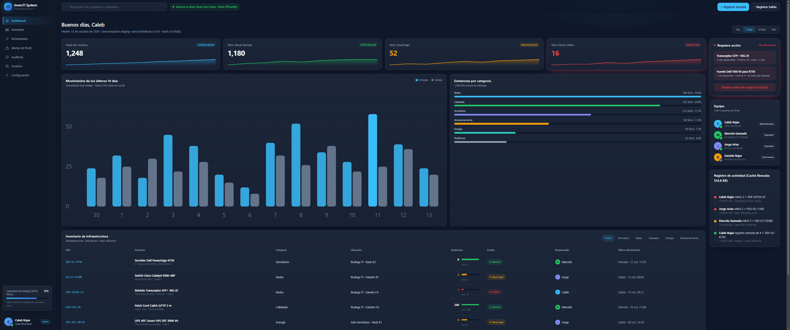
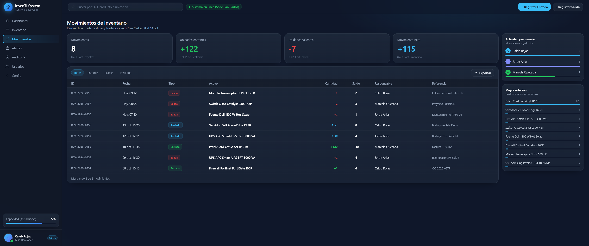

# 📦 InvenTI System (Case Study)

> **🔒 Nota de confidencialidad:** El código fuente de esta aplicación es de carácter privado y propietario. Este repositorio documenta únicamente la arquitectura, el caso de uso y los módulos funcionales del sistema.

---

## 🎯 Descripción General
**InvenTI System** es una solución web Full Stack orientada al control, gestión y auditoría centralizada de inventarios y activos técnicos en tiempo real. Fue diseñada para sustituir el control manual en hojas de cálculo desactualizadas, resolviendo cuellos de botella en el registro de insumos, pérdidas de stock y falta de trazabilidad.

---

## 💻 Interfaz y Módulos del Sistema

### 1. Panel de Control & Métricas de Inventario
Vista general interactiva que consolida métricas críticas en tiempo real: total de SKUs, estado de salud de stock (Normal, Bajo, Crítico), distribución por categorías y registro de actividades recientes.

---

### 2. Kardex de Movimientos & Trazabilidad
Módulo especializado para la auditoría de Entradas, Salidas y Traslados entre bodegas. Garantiza un control preciso sobre cantidades, saldos de stock, responsables y referencias de orden.

---

## 🛠️ Stack Tecnológico

  

- **Backend:** Node.js, Express (API RESTful)
- **Frontend:** React.js, HTML5, CSS3 (Diseño responsivo y modular)
- **Base de Datos:** MySQL
- **Control de Versiones:** Git / GitHub

---

## 🚀 Módulos y Funcionalidades Principales

### 1. Panel de Control & Métricas
- Métricas consolidadas en tiempo real: Total de SKU, niveles de existencia y alertas de stock bajo.
- Monitor de salud de inventario e historial de movimientos.

### 2. Gestión de Activos e Inventario
- Registro detallado de productos, categorías, estados y ubicaciones.
- Control de entradas y salidas de stock con actualización inmediata de existencias.

### 3. Registro de Auditoría
- Trazabilidad de operaciones para control interno de modificaciones de datos.

---

## 🏗️ Arquitectura
El sistema opera bajo una arquitectura cliente-servidor acoplada mediante una API RESTful:
1. **Cliente (React):** Interfaz SPA optimizada para navegación fluida e interacción en tiempo real.
2. **Servidor (Express):** Validación de datos, procesamiento de lógica de negocio y gestión de peticiones.
3. **Persistencia (MySQL):** Modelado relacional normalizado para garantizar la integridad de los datos.

